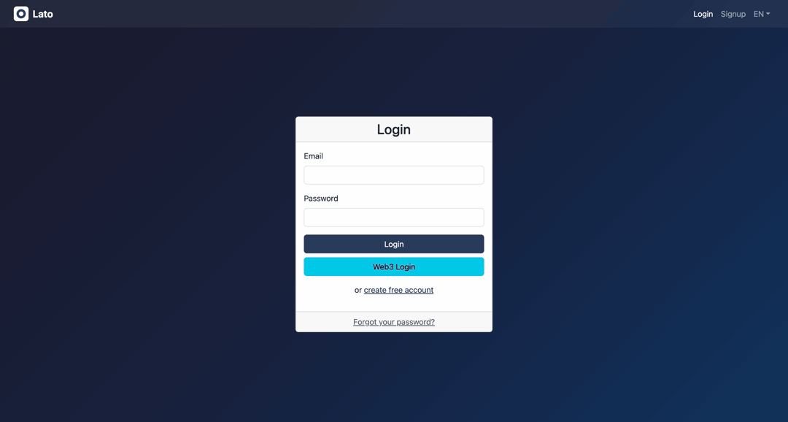

# Lato

[](https://badge.fury.io/rb/lato)

Lato is a Rails Engine that offers a comprehensive web application starter kit with user management, authentication, and UI components for [Ruby on Rails](https://rubyonrails.org/).

This gem includes:
- User management with **full authentication system** (signin, signup, recover password, email validation, Google Authenticator and WebAuthn/passkey multi-factor authentication, ETH wallet connection) and **account management** (user settings, password change, email change, etc.);
- **Web interface** built with [Bootstrap](https://getbootstrap.com/) and [Bootstrap Icons](https://icons.getbootstrap.com/);
- **UI components integrated with Rails** (data tables, forms, modals, async job executions etc.);
- **Accessibility built in**: labelled form fields with linked error messages, keyboard friendly modals with focus return, skip link, `aria-sort` on tables, live regions for feedback and WCAG 2.2 target sizes. Core pages report zero axe-core violations on WCAG 2.2 AA rules;

The gem is **agnostic to the application stack**. You can use it with different databases (PostgreSQL, MySQL, SQLite), different Job processors (Solid queue, Sidekiq, Delayed Job, etc.), different cache systems (Redis, Memcached, etc.).

The gem is designed to be easily **customizable and extendable**. You can fully customize the UI and the functionalities of the panel. You can also add new functionalities and components to the panel on the main application or develop new engines to extend the panel.

The gem is ready to be used with the **Rails 8.1.3.1 or later within the 8.1 series** features like **[ESM import maps](https://github.com/rails/importmap-rails)**, **[Turbo](https://turbo.hotwired.dev/)** and **[Stimulus](https://stimulus.hotwired.dev)**. The front-end is designed to be responsive and mobile friendly, with accessibility improvements in progress (see the component notes in the documentation).



## Full documentation

The full documentation is available here: 👉 👉 [DOCUMENTATION](https://lato-oss.gregoriogalante.com) 👈 👈

### Working with LLMs

The `SKILL.md` usable with LLMs to generate code and get helps with the gem is available here: 👉 [SKILL.md](https://github.com/Lato-org/lato/raw/refs/heads/main/docs/SKILL.md) 👈

The `documentation.txt` file with all the context to use with LLMs is available here: 👉 [documentation.txt](https://github.com/Lato-org/lato/raw/refs/heads/main/docs/documentation.txt) 👈

## Eco-system
The idea behind Lato is to create an eco-system of engines that can improve the functionalities of the panel. The following engines are already available:

- [Lato Spaces](https://github.com/Lato-org/lato_spaces): manage multiple workspaces in the panel with user invitation and workspace roles;
- [Lato Settings](https://github.com/Lato-org/lato_settings): manage application settings from the UI panel;
- [Lato Storage](https://github.com/Lato-org/lato_storage): manage storage (Active Storage data) from the UI panel;
- [Lato Users](https://github.com/Lato-org/lato_users): manage users from the UI panel;
- [Lato CMS](https://github.com/Lato-org/lato_cms): manage web pages from the UI panel;

## Installation
Add required dependencies to your application's Gemfile:

```ruby
# Use JavaScript with ESM import maps [https://github.com/rails/importmap-rails]
gem "importmap-rails" # NOTE: Probably already installed in default Rails 8 project

# Hotwire's SPA-like page accelerator [https://turbo.hotwired.dev]
gem "turbo-rails" # NOTE: Probably already installed in default Rails 8 project

# Hotwire's modest JavaScript framework [https://stimulus.hotwired.dev]
gem "stimulus-rails" # NOTE: Probably already installed in default Rails 8 project

# Use Sass to process CSS
gem "sassc-rails"

# Use lato as application panel
gem "lato"
```

If not already present, add `app/assets/config/manifest.js` file with the following content:

```js
//= link_tree ../images
//= link_directory ../stylesheets .css
//= link_tree ../../javascript .js
//= link_tree ../../../vendor/javascript .js
```

Install gem and run required tasks:

```bash
bundle
rails active_storage:install
rails lato:install:application
rails lato:install:migrations
rails db:migrate
```

Lato stores rate limits, password recovery codes, email verification codes and semaphores in `Rails.cache`. Use a persistent cache shared across processes (Redis, Solid Cache, Memcached): with `:null_store` password recovery never works and rate limits are disabled, with `:memory_store` and multiple processes limits are per process.

To use the Web3 (ETH wallet) authentication add `gem "eth"` to your Gemfile, it is not a dependency of Lato.

Mount lato routes on the **config/routes.rb** file:

```ruby
Rails.application.routes.draw do
  mount Lato::Engine => "/lato"

  # ....
end
```

Import Lato Scss on **app/assets/stylesheets/application.scss** file:
```scss
@import 'lato/application';

// ....
```

Import Lato Js on **app/javascript/application.js** file:
```js
import "lato/application";

// ....
```

Setup I18n on the **config/application.rb** file:

```ruby
module MyApplication
  class Application < Rails::Application
    config.i18n.available_locales = [:it, :en]
    config.i18n.default_locale = :it

    # ...
  end
end

```

Lato ships translations for `it`, `en`, `fr` and `ro`. Any key can be overridden in your application locale files. Emails exist only in Italian and English: users with locale `it` receive Italian emails, every other locale receives English.

### Extra tasks
Lato integrates by default a basic PWAs manifest and service worker. To re-generate them with all required assets follow these steps:

1. Complete the configuration of lato on a custom initializer (see [configuration](https://github.com/lato-org/lato/blob/main/lib/lato/config.rb) options for more details)
2. Add an icon.png file on **public/icon.png** with minimum size of 512x512px
3. Run the following commands:

```bash
rails lato:generate:favicon
rails lato:generate:pwa
```

## Upgrading

To upgrade Lato to the latest version, run the following commands:

```bash
bundle update lato
rails lato:install:application
rails lato:install:migrations
rails db:migrate
```

Read [UPGRADING.md](UPGRADING.md) for the changes and extra steps required by each version.

## Security recommendations for your application

Lato ships secure defaults, but some settings belong to the Rails application that uses it. These recommendations help applications using Lato reach a higher security level in production:

- Set `config.force_ssl = true`: the session cookie is `secure` only when the request is SSL.
- Use a persistent `Rails.cache` shared across processes (Redis, Solid Cache, Memcached). Recovery codes, verification codes and rate limits depend on it.
- Set `config.action_controller.raise_on_open_redirects = true`.
- Enable a Content Security Policy. Lato views need no inline scripts: enable nonces for the importmap tags (`config.content_security_policy_nonce_generator` and `content_security_policy_nonce_directives = %w[script-src]`) instead of `'unsafe-inline'`. Lato serves all its scripts, stylesheets and fonts through the asset pipeline, so `script-src`, `style-src` and `font-src` need no third-party CDN. Only these extra sources are needed:
  - `hcaptcha.com` and `*.hcaptcha.com` (only with hCaptcha enabled): `script-src`, `frame-src`, `style-src` and `connect-src`.
  - `data:` in `img-src` for the authenticator QR code. Views use inline `style` attributes, so `style-src` still needs `'unsafe-inline'`.
- Set `Lato.config.session_idle_timeout` (e.g. `30.minutes`) and review `session_lifetime` (default 30 days, absolute).
- Review `Lato.config.invitation_lifetime` (default 30 days) and destroy pending invitations that are no longer needed.
- WebAuthn: use HTTPS origins in `webauthn_origin`. Set `webauthn_user_verification = "required"` if all your users have authenticators with biometrics or PIN.
- Encrypt authenticator secrets: configure Active Record encryption keys (`bin/rails db:encryption:init`) and set `Lato.config.encrypt_authenticator_secret = true` in an initializer. With existing plaintext secrets, set `config.active_record.encryption.support_unencrypted_data = true` until they are re-encrypted.
- Configure hCaptcha (`hcaptcha_site_key`, `hcaptcha_secret`) to protect signup and password recovery.
- Schedule `Lato::LatoOperationsCleanerJob` and `Lato::ActiveStorageCleanerJob`: they are not scheduled automatically.
- Monitor failed signins: the per-email signin limit can be used to temporarily lock out a known email.

## Development

Clone repository, install dependencies, run migrations and start:

```bash
git clone https://github.com/lato-org/lato
cd lato
bundle
rails db:migrate
rails db:seed
foreman start -f Procfile.dev
```

### Publish

This script will publish the gem to rubygems.org. Make sure you have the correct permissions and that you are logged in to your rubygems account.

```bash
ruby ./bin/publish.rb
```

### Generate documentation

This script will generate the documentation for the gem by exporting the Rails rendered views to HTML files. The documentation will be generated in the **docs** folder.

Make sure to have the server running on port 3000 before running the script.

```bash
ruby ./bin/generate_docs.rb
```

## License
The gem is available as open source under the terms of the [MIT License](https://opensource.org/licenses/MIT).
